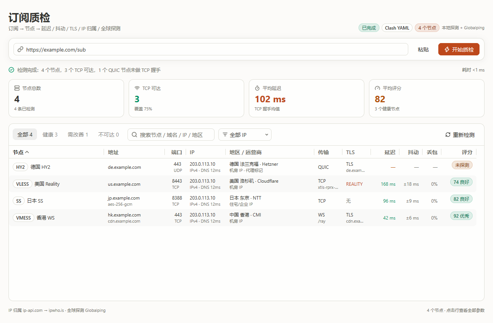
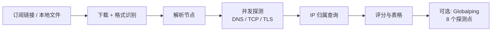

# 订阅质检 · ipscan

**粘贴一条订阅，得到每个节点的真实质量。** 原生跨平台桌面应用，不做代理、不接管系统网络，只做检测。

<p align="center">
  
  
  
  
  
  
  
  
</p>



## 目录

- [它解决什么问题](#它解决什么问题)
- [功能](#功能)
- [快速开始](#快速开始)
- [使用](#使用)
- [检测原理](#检测原理)
- [支持的订阅格式与协议](#支持的订阅格式与协议)
- [界面预览](#界面预览)
- [项目结构](#项目结构)
- [开发](#开发)
- [数据来源与隐私](#数据来源与隐私)
- [已知限制](#已知限制)
- [免责声明](#免责声明)
- [许可证](#许可证)

## 它解决什么问题

订阅链接通常只告诉你“有哪些节点”，不告诉你“哪些节点能用、有多快、是不是机房 IP”。
机场面板的延迟未必是你的延迟，节点名里的国旗和城市也可能与真实落地不符。

`ipscan` 把一条订阅拆成节点清单，在本机逐个测量 DNS / TCP / TLS，再查询 IP 归属与线路类型，
需要时从全球 8 个探测点 ping 同一个地址。所有结果落在一张可排序、可筛选、可搜索的表格里。

- **不用装内核**：纯检测工具，不建立代理连接、不改路由和 DNS。
- **不看广告看数据**：延迟、抖动、丢包、TLS、IP 类型、全球可达性各自成列。
- **原生界面**：Go + Onevra/MyGo 直接绘制，没有 WebView，没有 Electron。

## 功能

| 能力 | 说明 |
| --- | --- |
| 订阅解析 | Clash / Mihomo YAML、Xray 配置 JSON、sing-box JSON、base64、明文 URI 列表；自动识别、支持 gzip |
| 本地探测 | DNS 解析、3 次 TCP 握手、TLS 握手与证书信息；8 并发，逐行回填结果 |
| 质量评分 | 1–100 分，延迟为主、抖动次之、丢包重罚，TLS 失败额外扣分 |
| IP 归属 | 国家 / 城市 / ISP / ASN，标记机房、代理、移动网络 |
| IP 类型筛选 | 全部 / 住宅·企业 / 机房 / 移动网络 |
| 全球探测 | Globalping 8 个探测点 ping，含 Anycast / CDN 就近边缘识别 |
| 表格交互 | 任意列排序（中文按拼音）、状态分页、全文搜索、列宽拖拽并自适应窗口 |
| 节点详情 | 连接质量、IP 归属、TLS 证书、全部协议参数、一键复制原始链接 |
| 国旗渲染 | 内置 249 面国旗 PNG，按节点名前缀自动识别（`hk`、`KR 韩国`、`🇯🇵` 等） |
| 容错 | 单条坏节点只记警告，不影响其余节点；订阅获取/归属查询失败可重试 |

## 快速开始

### 直接使用

从 [Releases](https://github.com/qzh200/ipscan/releases/latest) 下载对应平台的压缩包：

| 平台 | 文件 | 要求 |
| --- | --- | --- |
| Windows x64 / ARM64 | `ipscan_*_windows_*.zip` | Windows 10/11，解压即用 |
| Linux x64 / ARM64 | `ipscan_*_linux_*.tar.gz` | GTK 3 + WebKitGTK 4.1 |
| macOS Intel / Apple Silicon | `ipscan_*_darwin_*.tar.gz` | macOS 12+ |

```bash
# Linux 运行依赖（Debian / Ubuntu）
sudo apt install libgtk-3-0 libwebkit2gtk-4.1-0
# Fedora
sudo dnf install gtk3 webkit2gtk4.1

# macOS 未签名构建，首次运行移除隔离属性
xattr -d com.apple.quarantine ./ipscan
```

解压后运行 `ipscan.exe`（Windows）或 `./ipscan`（Linux / macOS），粘贴订阅链接或本地文件路径，点击 **开始质检**。

输入框接受：

```text
https://example.com/api/v1/client/subscribe?token=...
file:///D:/subs/clash.yaml
D:\subs\clash.yaml
```

### 从源码构建

需要 Go 1.27+，可在任意平台交叉编译：

```powershell
git clone https://github.com/qzh200/ipscan.git
cd ipscan

# 当前平台
go build -trimpath -ldflags="-s -w" -o ipscan.exe ./cmd/ipscan

# 交叉编译
$env:GOOS="linux"; $env:GOARCH="amd64"; $env:CGO_ENABLED="0"
go build -trimpath -ldflags="-s -w" -o ipscan-linux-amd64 ./cmd/ipscan
```

架构：`windows` / `linux` / `darwin` × `amd64` / `arm64`。MyGo 为纯 Go 实现，无需 CGO。

`gopkg.in/yaml.v3` 通过 `replace` 指向仓库内的 `third_party/yaml`，其余依赖走模块代理。

## 使用

1. **粘贴订阅**：自动识别格式，顶部徽标显示检测到的格式与节点数。
2. **等待检测**：进度按完成数推进；随时可以中止，已完成的行保留结果。
3. **看表**：默认按名称拼音排序，点击表头切换排序列与方向。
   - 顶部四个统计卡随当前筛选范围变化。
   - 搜索框匹配节点名、域名、IP、地区、协议。
   - “需改善”“不可达”页签快速定位问题节点。
4. **进详情**：点击任意行查看完整参数；在详情页发起全球 Ping 或复制节点链接。
5. **重新检测**：工具栏右侧按钮复测当前列表，无需重新下载订阅。

快捷操作：`粘贴` 读取剪贴板；在输入框按回车等同于开始质检。

## 检测原理



### 本地测量

- **DNS**：解析域名的全部地址，优先选择可连通的地址。
- **TCP**：对 `IP:端口` 连续握手 3 次，统计 min / avg / max / 抖动与丢包。
- **TLS**：`tls` / `reality` 节点完成握手，读取版本、加密套件、证书 CN、签发者、到期时间与校验结果。
- **QUIC 节点**：`hysteria`、`hysteria2`、`tuic` 的 TCP 端口通常不监听，因此不做可达性判定，展示为“未探测”，但仍查询 IP 质量。

### 评分

基础分 100，按以下规则递减，最终夹在 1–100：

| 指标 | 区间 | 扣分 |
| --- | --- | --- |
| 平均延迟 | ≤ 80 ms | 0 |
| | ≤ 150 ms | −5 |
| | ≤ 250 ms | −12 |
| | ≤ 400 ms | −22 |
| | ≤ 700 ms | −35 |
| | > 700 ms | −50 |
| 抖动 | ≤ 10 ms | 0 |
| | ≤ 30 ms | −5 |
| | ≤ 80 ms | −12 |
| | > 80 ms | −20 |
| 丢包 | `loss × 45` | 0 ~ −45 |
| TLS 握手失败 | 仅 `tls` / `reality` 节点 | −10 |

等级：`≥85 优秀`、`≥70 良好`、`≥50 一般`、`<50 较差`；不可达为 `不可达`。

### Anycast 识别

CDN / Anycast 节点会让每个探测点都“就近接入”，于是出现东京 1 ms、洛杉矶 2 ms、赫尔辛基 17 ms 且 0 丢包的物理不可能结果。

`ipscan` 用探测点坐标做交叉验证：任意两个探测点相距 ≥ 2500 km 时，往返时延不可能低于 `2 × 距离 / 200 km/ms`（光纤传播上限）。若两点 RTT 之和低于该下限的 0.8 倍，则判定为命中共享边缘：

- 报告中的中位数 / 最小值 / 最大值排除这些探测点；
- 全部命中时摘要显示“全部命中就近边缘（Anycast/CDN）”，表格显示 `全球 边缘`，而不是假延迟。

## 支持的订阅格式与协议

**自动识别的输入**

| 输入 | 说明 |
| --- | --- |
| Clash / Mihomo YAML | 读取 `proxies:` 列表 |
| Xray / v2ray 配置 JSON | 读取 `outbounds` 中的代理节点 |
| sing-box JSON | 读取 `outbounds` 中的代理节点 |
| base64 | 允许空白与 76 列换行，可多层嵌套（最多 3 层） |
| 明文 URI 列表 | 每行一条分享链接，`#` 开头视为注释 |
| gzip | 先解压再识别 |

**协议**

`vmess` · `vless` · `trojan` · `shadowsocks (ss)` · `shadowsocksr (ssr)` · `hysteria` · `hysteria2 / hy2` · `tuic` · `socks5` · `http(s)`

**传输与安全**

`tcp` · `ws` · `grpc` · `h2` · `httpupgrade` · `quic` · `kcp`，安全层支持 `none` / `tls` / `reality`，并解析 SNI、Host、Path、ALPN、uTLS 指纹、REALITY 公钥与短 ID、SIP003 插件等参数。

## 界面预览

<details>
<summary>节点详情页</summary>


</details>

- 列表页：品牌区 → 订阅卡片 → 状态行 → 统计卡 → 工具栏/表格 → 页脚。
- 详情页整页替换列表，`返回列表` 保留当前筛选与搜索条件。
- 主题跟随 `light-dark()`，系统深色模式下自动切换。

## 项目结构

```text
cmd/ipscan              窗口、图标嵌入与依赖装配
internal/model          节点模型、国家前缀解析、排序名
internal/subscription   下载、格式识别、Clash / JSON / URI 解析
internal/probe          DNS / TCP / TLS 测量、评分、IP 归属
internal/remote         Globalping 全球探测、Anycast 判定
internal/scan           工作池、有序结果、归属补全
internal/app            状态机、异步任务、快照（无绘制）
internal/screen         Onevra 界面绘制（只读快照）
internal/flags          内置国旗 PNG 与缓存
```

约束：`app` 不导入 UI，`screen` 不直接发起网络请求；所有网络工作通过 `app` 的任务执行，
界面只消费 `app.Snapshot()`。这样检测逻辑可以脱离界面单独测试。

## 开发

```powershell
go test ./...                      # 单元测试 + 无头界面快照
go vet ./...
go build -o ipscan.exe ./cmd/ipscan
```

- 界面快照由 `internal/screen` 的测试生成到 `%TEMP%\ipscan-*.png`，用于检查布局回归。
- `internal/screen` 使用 Onevra 无头测试器，可在没有窗口的情况下断言文案、表格与筛选结果。
- 表格宽度、评分、Anycast 判定、国家前缀与订阅解析均有独立测试覆盖。

## 数据来源与隐私

| 数据 | 来源 |
| --- | --- |
| IP 归属 | [ip-api.com](http://ip-api.com) 批量接口，失败时回退 [ipwho.is](https://ipwho.is) |
| 全球延迟 | [Globalping](https://globalping.io) 公共测量 API |
| 国旗图片 | [flagcdn.com](https://flagcdn.com) / [lipis/flag-icons](https://github.com/lipis/flag-icons) |

- 订阅内容只在本机解析；**节点服务器地址会发送给上述归属与探测服务**，这是检测的必要条件。
- 应用不上传订阅链接、UUID、密码或节点名称，也没有账号体系和统计上报。
- Globalping 匿名额度约 500 次测量/小时，超出会返回 429。

## 已知限制

- 仅提供 64 位二进制；Linux 运行时需要系统安装 GTK 3 与 WebKitGTK 4.1。
- macOS 与 Windows 构建未代码签名，首次运行可能被 Gatekeeper / SmartScreen 拦截。
- 测量的是“本机到节点入口”的质量，不代表节点落地后的出口带宽与流媒体解锁能力。
- 不解析订阅里的流量、到期时间等元信息（`subscription-userinfo`）。
- QUIC 协议节点无法通过 TCP 握手判定可用性，只能展示 IP 归属。
- 免费归属接口有速率限制，节点很多时部分行可能没有归属数据。

## 免责声明

本项目仅用于检测与分析自己有权使用的订阅，不提供代理服务，不绕过任何网络限制。
请遵守所在地区法律法规及服务商条款；因使用本工具产生的任何后果由使用者自行承担。

## 许可证

Copyright (C) 2026 跨越星轨的客 (GitHub: [@qzh200](https://github.com/qzh200))

本项目以 **GNU General Public License v3.0 or later**（GPL-3.0-or-later）发布，
完整许可证文本见 [LICENSE](LICENSE)。

你可以自由使用、修改和分发本软件，包括商业使用；但分发时必须：

- 提供完整源代码，衍生作品同样以 GPL-3.0-or-later 授权；
- 保留版权声明与许可证文本；
- 说明你做出的修改。

本软件按“现状”提供，不附带任何明示或默示担保。
