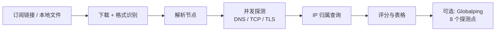
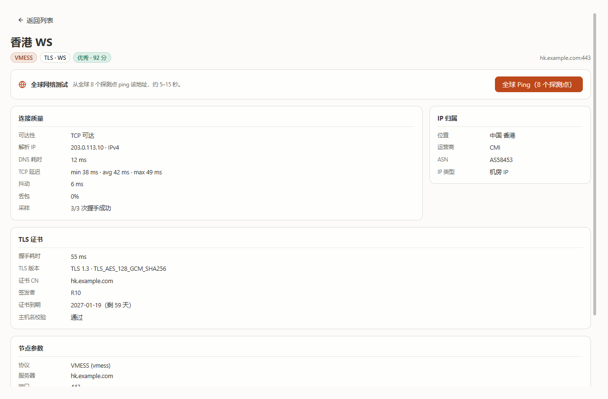

# 订阅质检 · ipscan

一个纯 Go 原生桌面的订阅与节点质量检测工具：粘贴 Clash / Xray / sing-box 订阅链接，
解析全部节点，逐条测量 TCP 握手延迟、抖动、丢包与 TLS 握手/证书，并查询 IP 归属、
运营商与机房/代理标记。界面用 [Onevra](https://github.com/oneo-me/onevra)（MyGo 原生 UI
设计系统）在 GPU 上绘制：暖白纸张底色、陶土强调色、卡片式统计与可排序/拖拽列宽的数据表，
不依赖 WebView。
**粘贴一条订阅，得到每个节点的真实质量。** 原生 Windows 桌面应用，不做代理、不接管系统网络，只做检测。

## 构建与运行


```sh


## 目录

- [它解决什么问题](#它解决什么问题)
- [功能](#功能)
- [快速开始](#快速开始)
- [使用](#使用)
- [检测原理](#检测原理)
- [支持的订阅格式与协议](#支持的订阅格式与协议)
- [界面预览](#界面预览)
- [项目结构](#项目结构)
- [开发](#开发)
- [数据来源与隐私](#数据来源与隐私)
- [已知限制](#已知限制)
- [免责声明](#免责声明)
- [许可证](#许可证)

## 它解决什么问题

订阅链接通常只告诉你“有哪些节点”，不告诉你“哪些节点能用、有多快、是不是机房 IP”。
机场面板的延迟未必是你的延迟，节点名里的国旗和城市也可能与真实落地不符。

`ipscan` 把一条订阅拆成节点清单，在本机逐个测量 DNS / TCP / TLS，再查询 IP 归属与线路类型，
需要时从全球 8 个探测点 ping 同一个地址。所有结果落在一张可排序、可筛选、可搜索的表格里。

- **不用装内核**：纯检测工具，不建立代理连接、不改路由和 DNS。
- **不看广告看数据**：延迟、抖动、丢包、TLS、IP 类型、全球可达性各自成列。
- **原生界面**：Go + Onevra/MyGo 直接绘制，没有 WebView，没有 Electron。

## 功能

| 能力 | 说明 |
| --- | --- |
| 订阅解析 | Clash / Mihomo YAML、Xray 配置 JSON、sing-box JSON、base64、明文 URI 列表；自动识别、支持 gzip |
| 本地探测 | DNS 解析、3 次 TCP 握手、TLS 握手与证书信息；8 并发，逐行回填结果 |
| 质量评分 | 1–100 分，延迟为主、抖动次之、丢包重罚，TLS 失败额外扣分 |
| IP 归属 | 国家 / 城市 / ISP / ASN，标记机房、代理、移动网络 |
| IP 类型筛选 | 全部 / 住宅·企业 / 机房 / 移动网络 |
| 全球探测 | Globalping 8 个探测点 ping，含 Anycast / CDN 就近边缘识别 |
| 表格交互 | 任意列排序（中文按拼音）、状态分页、全文搜索、列宽拖拽并自适应窗口 |
| 节点详情 | 连接质量、IP 归属、TLS 证书、全部协议参数、一键复制原始链接 |
| 国旗渲染 | 内置 249 面国旗 PNG，按节点名前缀自动识别（`hk`、`KR 韩国`、`🇯🇵` 等） |
| 容错 | 单条坏节点只记警告，不影响其余节点；订阅获取/归属查询失败可重试 |

## 快速开始

### 直接使用

1. 下载并运行 `ipscan.exe`（Windows 10/11，无需安装）。
2. 粘贴订阅链接或本地文件路径。
3. 点击 **开始质检**。

输入框接受：

```text
https://example.com/api/v1/client/subscribe?token=...
file:///D:/subs/clash.yaml
D:\subs\clash.yaml
```

### 从源码构建

需要 Go 1.27+ 与 Windows 环境：

```powershell
git clone https://github.com/qzh200/ipscan.git
cd ipscan
go build -o ipscan.exe ./cmd/ipscan
./ipscan.exe
.\ipscan.exe
```

- Go 1.27+，Windows / macOS / Linux。
- `third_party/yaml` 是 yaml.v3 的本地副本（MIT/Apache），让没有模块代理的环境也能离线构建。
`gopkg.in/yaml.v3` 通过 `replace` 指向仓库内的 `third_party/yaml`，其余依赖走模块代理。

## 支持的订阅格式
## 使用

| 格式 | 识别方式 |
1. **粘贴订阅**：自动识别格式，顶部徽标显示检测到的格式与节点数。
2. **等待检测**：进度按完成数推进；随时可以中止，已完成的行保留结果。
3. **看表**：默认按名称拼音排序，点击表头切换排序列与方向。
   - 顶部四个统计卡随当前筛选范围变化。
   - 搜索框匹配节点名、域名、IP、地区、协议。
   - “需改善”“不可达”页签快速定位问题节点。
4. **进详情**：点击任意行查看完整参数；在详情页发起全球 Ping 或复制节点链接。
5. **重新检测**：工具栏右侧按钮复测当前列表，无需重新下载订阅。

快捷操作：`粘贴` 读取剪贴板；在输入框按回车等同于开始质检。

## 检测原理



### 本地测量

- **DNS**：解析域名的全部地址，优先选择可连通的地址。
- **TCP**：对 `IP:端口` 连续握手 3 次，统计 min / avg / max / 抖动与丢包。
- **TLS**：`tls` / `reality` 节点完成握手，读取版本、加密套件、证书 CN、签发者、到期时间与校验结果。
- **QUIC 节点**：`hysteria`、`hysteria2`、`tuic` 的 TCP 端口通常不监听，因此不做可达性判定，展示为“未探测”，但仍查询 IP 质量。

### 评分

基础分 100，按以下规则递减，最终夹在 1–100：

| 指标 | 区间 | 扣分 |
| --- | --- | --- |
| 平均延迟 | ≤ 80 ms | 0 |
| | ≤ 150 ms | −5 |
| | ≤ 250 ms | −12 |
| | ≤ 400 ms | −22 |
| | ≤ 700 ms | −35 |
| | > 700 ms | −50 |
| 抖动 | ≤ 10 ms | 0 |
| | ≤ 30 ms | −5 |
| | ≤ 80 ms | −12 |
| | > 80 ms | −20 |
| 丢包 | `loss × 45` | 0 ~ −45 |
| TLS 握手失败 | 仅 `tls` / `reality` 节点 | −10 |

等级：`≥85 优秀`、`≥70 良好`、`≥50 一般`、`<50 较差`；不可达为 `不可达`。

### Anycast 识别

CDN / Anycast 节点会让每个探测点都“就近接入”，于是出现东京 1 ms、洛杉矶 2 ms、赫尔辛基 17 ms 且 0 丢包的物理不可能结果。

`ipscan` 用探测点坐标做交叉验证：任意两个探测点相距 ≥ 2500 km 时，往返时延不可能低于 `2 × 距离 / 200 km/ms`（光纤传播上限）。若两点 RTT 之和低于该下限的 0.8 倍，则判定为命中共享边缘：

- 报告中的中位数 / 最小值 / 最大值排除这些探测点；
- 全部命中时摘要显示“全部命中就近边缘（Anycast/CDN）”，表格显示 `全球 边缘`，而不是假延迟。

## 支持的订阅格式与协议

**自动识别的输入**

| 输入 | 说明 |
| --- | --- |
| 节点链接列表 | 每行一个 `vmess://` `vless://` `trojan://` `ss://` `ssr://` `hysteria2://` `tuic://` `socks5://` |
| base64 订阅 | 自动解码（标准 / URL-safe，带或不带 padding），可嵌套检测内部格式 |
| Clash / Mihomo YAML | `proxies[].type` 覆盖 vmess、vless、trojan、ss、ssr、hysteria、hysteria2、tuic、socks5、http |
| Xray / v2ray JSON | `outbounds[].protocol` + `streamSettings`，读取 ws/grpc/h2/httpupgrade/xhttp 与 TLS/REALITY |
| sing-box JSON | `outbounds[]`，读取 `tls`、`reality`、`utls`、`transport`、`obfs` |
| Clash / Mihomo YAML | 读取 `proxies:` 列表 |
| Xray / v2ray 配置 JSON | 读取 `outbounds` 中的代理节点 |
| sing-box JSON | 读取 `outbounds` 中的代理节点 |
| base64 | 允许空白与 76 列换行，可多层嵌套（最多 3 层） |
| 明文 URI 列表 | 每行一条分享链接，`#` 开头视为注释 |
| gzip | 先解压再识别 |

单条坏节点只会记入“跳过 N 条”，不影响其余节点。
**协议**

## 展示内容
`vmess` · `vless` · `trojan` · `shadowsocks (ss)` · `shadowsocksr (ssr)` · `hysteria` · `hysteria2 / hy2` · `tuic` · `socks5` · `http(s)`

- 节点表：国旗 + 节点名（协议标签）、地址、端口（TCP/UDP）、IP、地区/运营商、传输协议（含路径/服务名/流控）、
  TLS（含 SNI）、延迟、抖动、丢包、评分；点击行在右侧查看全部参数。
- IP 质量：解析出的 IPv4/IPv6、DNS 耗时、位置、运营商、ASN、机房/移动网络、代理标记。
- 传输质量：TCP 握手 min/avg/max、抖动、丢包、评分（优秀/良好/一般/较差/不可达）。
- TLS：版本、套件、证书 CN/签发者/到期、主机名校验；QUIC 类节点（hysteria2/tuic）
  正常不监听 TCP，标为“未探测”并保留 IP 质量结果。
**传输与安全**

节点名里的国家前缀换成正版国旗：`amArmenia 電門`、`gb|UK London`、`KR 韩国 01`、
`🇭🇰Hong Kong` 都渲染成国旗图片 + 去掉前缀的名字，前缀不参与排序。前缀与名字之间的分隔可以
是空格（含不换行空格、全角空格）、`|`、`-`、`·`；国旗带 1px 描边，日本、韩国这类白色旗面
也不会看成一个小圆点。国旗是内嵌的 249 张 PNG
（`internal/flags`，来自 flagcdn.com / lipis flag-icons，MIT），不联网、也不依赖系统 emoji
字体（Windows 的 Segoe UI Emoji 根本不含国旗字形，只会显示 AM/AU 两个字母）。
`tcp` · `ws` · `grpc` · `h2` · `httpupgrade` · `quic` · `kcp`，安全层支持 `none` / `tls` / `reality`，并解析 SNI、Host、Path、ALPN、uTLS 指纹、REALITY 公钥与短 ID、SIP003 插件等参数。

IP 归属查询先走 ip-api.com 批量接口，被墙或限流时自动回退到 HTTPS 的 ipwho.is；
两者都失败时状态栏显示“归属查询失败”，延迟/TLS 结果不受影响。只发送解析出的公网 IP。
## 界面预览

## 界面
<details>
<summary>节点详情页</summary>

- Onevra 主题（明/暗自动跟随系统）：`theme.Apply` + 暖白/暖炭底色与陶土强调色。
- 组件：`Button`、`TextBox`、`Badge`、`Tabs`、`Table/TableRow`、`ScrollView`、`Progress`、
  `Spinner`、`Icon`（Lucide）。
- 列表页：订阅卡片、4 张统计卡、筛选/搜索、可拖拽调整列宽的数据表；窗口宽度 < 1240 时
  自动收紧列宽，避免右侧列被裁掉。状态标签、统计卡与页脚计数随 IP 类型/搜索筛选联动，
  页脚显示“显示 X / Y 个节点”。
- 表格始终横向填满卡片、绝不横向滚动：列宽按窗口比例分配，任何一列被拖宽后都会重新
  归一化到卡片宽度，右侧预留 12 px 给悬浮滚动条，评分徽标不会被裁切或被滚动条压住。
- 窗口标题为「订阅质检 · ipscan」，标题栏与任务栏图标是内嵌的 `cmd/ipscan/icon.png`
  （陶土色圆角方块 + 白色心跳线），由 `Window.SetIcon` 在创建窗口时设置。
- 排序：默认按名称（中文按拼音）升序；点击任意列头排序，再点一次切换升降序；
  评分首次按高到低，其余首次升序；未检测/QUIC 节点始终排在末尾。
- IP 类型筛选：全部 / 住宅·企业 / 机房 / 移动网络，可与状态筛选、搜索、排序叠加。
- 详情页：整页展示全球探测、连接质量、TLS 证书、IP 归属与全部节点参数，返回列表一键切换；
  未执行全球探测时只占一行，状态与操作合并展示。


## 全球多点检测
</details>

点击节点行打开详情，在“全球网络测试”里执行 **全球 Ping**：通过
[Globalping](https://globalping.io) 的公开 API 从 8 个海外探测点（国家、城市、运营商、ASN）
对节点地址做 ICMP ping，返回每个探测点的平均延迟与丢包，并汇总可达数/中位延迟/平均丢包。
结果同时写入表格“延迟”列的第二行（`全球 xxms`），悬停可看汇总。
- 列表页：品牌区 → 订阅卡片 → 状态行 → 统计卡 → 工具栏/表格 → 页脚。
- 详情页整页替换列表，`返回列表` 保留当前筛选与搜索条件。
- 主题跟随 `light-dark()`，系统深色模式下自动切换。

- 每个节点按需触发，同一时间只跑一个测量；重新加载订阅会取消并清空。
- 就近边缘识别：CDN / Anycast 目标会被各探测点就近接入，8 个城市同时给出 1–5 ms、
  0% 丢包。程序用探测点经纬度做物理下限校验（光纤往返 ≥ 距离/100 ms）：任意两个探测点
  的 RTT 之和低于该下限，说明两者不可能到达同一台远端主机。命中的探测点标“就近边缘”，
  其延迟不计入中位延迟，详情页给出说明；这种情况下表格“延迟”列显示 `全球 边缘`，
  而不是一个虚假的 5 ms。
- 未认证额度约 500 次测量/小时；目标地址会发送给 `api.globalping.io`。
- ping.pe 的前端使用私有 WebSocket 协议、没有公开 API，因此未直接接入；`remote.Pinger`
  是接口，后续可替换或增加其他探测服务。
## 项目结构

```sh
GOPROXY=off go test ./...
```text
cmd/ipscan              窗口、图标嵌入与依赖装配
internal/model          节点模型、国家前缀解析、排序名
internal/subscription   下载、格式识别、Clash / JSON / URI 解析
internal/probe          DNS / TCP / TLS 测量、评分、IP 归属
internal/remote         Globalping 全球探测、Anycast 判定
internal/scan           工作池、有序结果、归属补全
internal/app            状态机、异步任务、快照（无绘制）
internal/screen         Onevra 界面绘制（只读快照）
internal/flags          内置国旗 PNG 与缓存
```

约束：`app` 不导入 UI，`screen` 不直接发起网络请求；所有网络工作通过 `app` 的任务执行，
界面只消费 `app.Snapshot()`。这样检测逻辑可以脱离界面单独测试。

## 代码结构
## 开发

```
cmd/ipscan            窗口与依赖装配，内嵌窗口图标 icon.png
internal/model        节点模型（协议/传输/安全参数）与国家前缀识别
internal/flags        内嵌的国旗图片（ISO 代码 → PNG）
internal/subscription 下载与格式识别、URI/Clash/Xray/sing-box 解析
internal/probe        DNS、TCP、TLS 探测，评分与 IP 归属
internal/remote       第三方多地点探测（Globalping）
internal/scan         有限并发调度与进度上报
internal/app          应用状态、异步任务与取消（不依赖 UI）
internal/screen       仅绘图：订阅栏、统计、节点表、详情抽屉
```powershell
go test ./...                      # 单元测试 + 无头界面快照
go vet ./...
go build -o ipscan.exe ./cmd/ipscan
```

## 测试
- 界面快照由 `internal/screen` 的测试生成到 `%TEMP%\ipscan-*.png`，用于检查布局回归。
- `internal/screen` 使用 Onevra 无头测试器，可在没有窗口的情况下断言文案、表格与筛选结果。
- 表格宽度、评分、Anycast 判定、国家前缀与订阅解析均有独立测试覆盖。

```sh
GOPROXY=off go test ./...
```
## 数据来源与隐私

解析、探测（本地回环监听器）、并发调度与界面渲染均有测试。
| 数据 | 来源 |
| --- | --- |
| IP 归属 | [ip-api.com](http://ip-api.com) 批量接口，失败时回退 [ipwho.is](https://ipwho.is) |
| 全球延迟 | [Globalping](https://globalping.io) 公共测量 API |
| 国旗图片 | [flagcdn.com](https://flagcdn.com) / [lipis/flag-icons](https://github.com/lipis/flag-icons) |

- 订阅内容只在本机解析；**节点服务器地址会发送给上述归属与探测服务**，这是检测的必要条件。
- 应用不上传订阅链接、UUID、密码或节点名称，也没有账号体系和统计上报。
- Globalping 匿名额度约 500 次测量/小时，超出会返回 429。

## 已知限制

- 仅支持 Windows；界面依赖 MyGo 的原生窗口能力。
- 测量的是“本机到节点入口”的质量，不代表节点落地后的出口带宽与流媒体解锁能力。
- 不解析订阅里的流量、到期时间等元信息（`subscription-userinfo`）。
- QUIC 协议节点无法通过 TCP 握手判定可用性，只能展示 IP 归属。
- 免费归属接口有速率限制，节点很多时部分行可能没有归属数据。

## 免责声明

本项目仅用于检测与分析自己有权使用的订阅，不提供代理服务，不绕过任何网络限制。
请遵守所在地区法律法规及服务商条款；因使用本工具产生的任何后果由使用者自行承担。

## 许可证

Copyright (C) 2026 跨越星轨的客 (GitHub: [@qzh200](https://github.com/qzh200))

本项目以 **GNU General Public License v3.0 or later**（GPL-3.0-or-later）发布，
完整许可证文本见 [LICENSE](LICENSE)。

你可以自由使用、修改和分发本软件，包括商业使用；但分发时必须：

- 提供完整源代码，衍生作品同样以 GPL-3.0-or-later 授权；
- 保留版权声明与许可证文本；
- 说明你做出的修改。

本软件按“现状”提供，不附带任何明示或默示担保。
